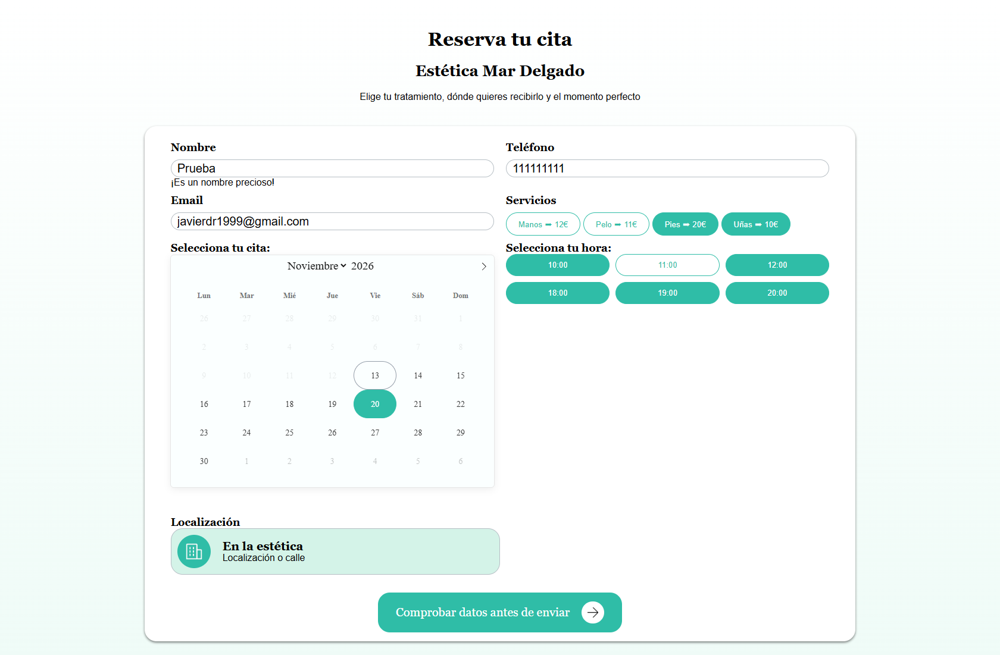
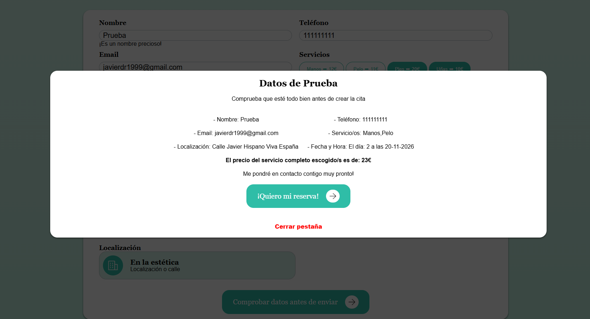
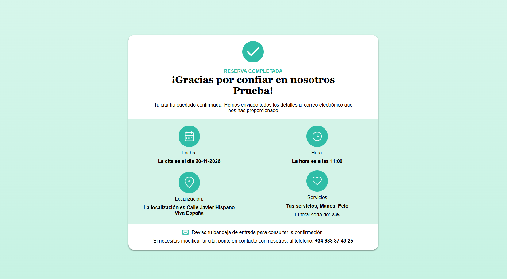
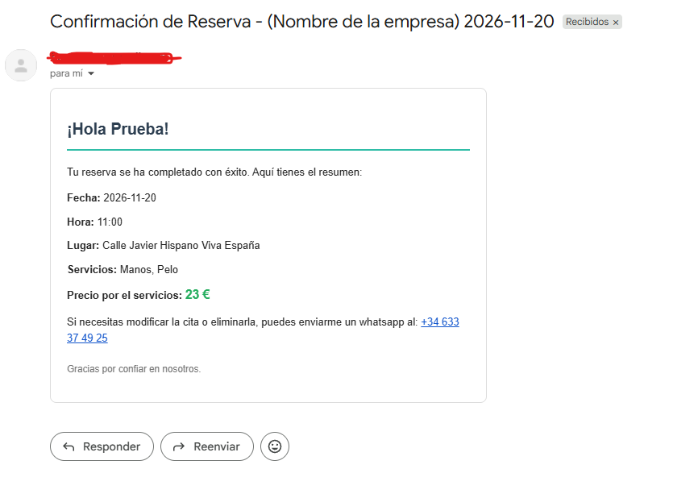
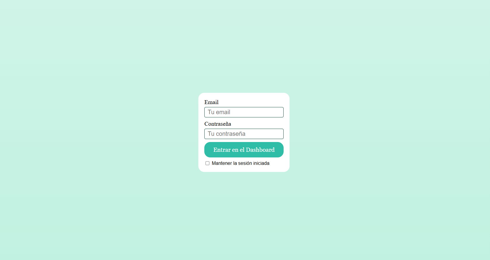
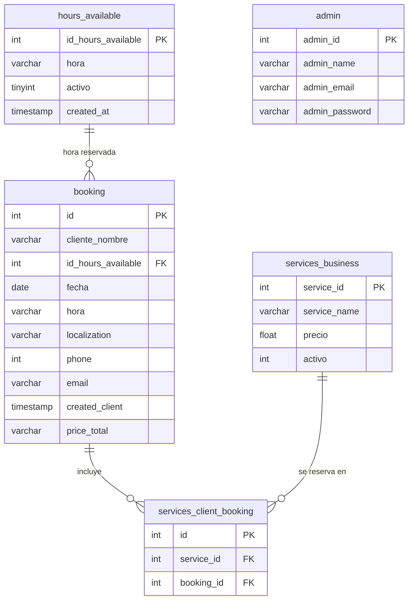

# 📅 Gestor de Citas (app-booking-simple)

Aplicación web para reservar citas. El cliente elige uno o varios servicios, el día y una hora libre en un calendario interactivo; la reserva se guarda en una base de datos relacional y se envía un correo de confirmación al cliente y otro a la empresa. Los administradores entran con usuario y contraseña a un panel donde ven todas las citas.



## 📸 Capturas

| Resumen antes de confirmar | Reserva confirmada |
| --- | --- |
|  |  |
| **Correo de confirmación al cliente** | **Acceso de administradores** |
|  |  |

## ✨ Funcionalidades

- **Reserva de citas:** selección de servicios, fecha (calendario con [flatpickr](https://flatpickr.js.org/)) y hora.
- **Horas libres en tiempo real:** las horas ya reservadas para ese día no se pueden elegir.
- **Precio total** calculado según los servicios elegidos.
- **Correos automáticos** (Python + SMTP): confirmación al cliente y aviso a la empresa con los datos de la cita.
- **Acceso de administradores** con sesión persistente de 7 días.
- **Panel de administración** con el listado de todas las citas.

## 🛠️ Tecnologías

| Capa | Tecnología |
| --- | --- |
| Frontend | HTML, CSS y JavaScript (fetch a la API propia), flatpickr |
| Backend | PHP con PDO y consultas preparadas, sesiones |
| Base de datos | MySQL / MariaDB |
| Automatizaciones | Python (`smtplib`, `python-dotenv`) |
| Entorno local | Laragon |

## 🗄️ Base de datos

La base de datos `booking` tiene 5 tablas:



| Tabla | Qué guarda |
| --- | --- |
| `booking` | Cada cita: datos del cliente, fecha, hora, lugar y precio total. |
| `hours_available` | Las franjas horarias que ofrece el negocio. Con `activo` se activan o desactivan sin borrarlas. |
| `services_business` | El catálogo de servicios con su precio. También se pueden desactivar con `activo`. |
| `services_client_booking` | Tabla intermedia: une cada cita con los servicios que el cliente ha elegido (una cita puede tener varios servicios). |
| `admin` | Las personas que pueden entrar al panel de administración. |

**Relaciones:**
- Una hora de `hours_available` puede aparecer en muchas citas (en días distintos).
- `booking` y `services_business` tienen una relación **muchos a muchos**, resuelta con la tabla intermedia `services_client_booking`.

El esquema completo (solo estructura, sin datos) está en [`bdBooking.sql`](bdBooking.sql).

## 🔌 API

| Endpoint | Método | Devuelve |
| --- | --- | --- |
| `api/get-services.php` | GET | Servicios activos con su precio |
| `api/get-hours.php` | GET | Horas activas y horas ya reservadas por fecha |
| `api/get-client.php` | GET | Datos de las citas para el panel |
| `api/get-users.php` | GET | Datos de los usuarios |
<!-- Revisa que la columna "Devuelve" de get-client y get-users es correcta -->

## 🔐 Configuración y seguridad

- Las credenciales (base de datos y servidor de correo) están en un archivo **`.env`** que **no se sube al repositorio** (está en `.gitignore`).
- PHP lo lee con `config/env.php` y Python con `python-dotenv`: ambos usan el mismo archivo.
- En el repositorio solo está **`.env.example`**, con los nombres de las variables y sin valores.
- Todas las consultas usan **sentencias preparadas de PDO**.

## 🚀 Cómo ejecutarlo en local

**Requisitos:** Windows, Laragon (PHP 8 + MySQL/MariaDB), Node.js y Python 3.

1. Clona el repositorio dentro de la carpeta `www` de Laragon:
   ```bash
   git clone https://github.com/Javiier99/app-booking-simple.git
   cd app-booking-simple
   ```
2. Instala flatpickr:
   ```bash
   npm install
   ```
3. Crea el entorno de Python e instala sus dependencias:
   ```bash
   python -m venv .venv
   .venv\Scripts\pip install -r requirements.txt
   ```
   El entorno debe llamarse `.venv` y estar en la raíz: la app lanza los scripts con `.venv/Scripts/python.exe`.
4. Crea la base de datos `booking` e importa `bdBooking.sql` (por ejemplo, desde HeidiSQL).
5. Copia `.env.example` como `.env` y rellena los datos de la base de datos y del correo.
6. Arranca Laragon y abre `http://localhost/app-booking-simple/public/`.

## 📂 Estructura

```text
app-booking-simple/
├── api/                    # Endpoints que devuelven JSON
├── backend/
│   ├── automatisation/     # Scripts de Python para enviar correos
│   └── starts-sesion/      # Inicio de sesión de administradores
├── config/
│   ├── env.php             # Lee el archivo .env
│   └── database.php        # Conexión PDO a la base de datos
├── doc/img-software/       # Capturas de pantalla del README
├── public/                 # Punto de entrada (index.php), páginas, CSS, JS e imágenes
├── src/
│   └── get-client-form.php # Guarda la reserva y lanza los correos
├── .env.example            # Variables necesarias (sin valores)
├── bdBooking.sql           # Estructura de la base de datos
├── package.json            # Dependencias de JavaScript (flatpickr)
└── requirements.txt        # Dependencias de Python
```

## 💡 Qué he aprendido

- Diseñar una base de datos relacional con claves foráneas y una relación muchos a muchos.
- Crear una API en PHP y consumirla desde JavaScript con `fetch`.
- Conectar PHP con scripts de Python para automatizar tareas.
- Gestionar credenciales con variables de entorno en lugar de escribirlas en el código.

## 🔜 Próximas mejoras

- [ ] Botones de editar y borrar citas en el panel de administración.
- [ ] Guardar las contraseñas de administradores cifradas con `password_hash()`.
- [ ] Mejorar tipos de datos: `DECIMAL` para precios, `TIME` para horas y `VARCHAR` para teléfonos.
- [ ] Publicar una demo online.

---

Hecho por **Fco. Javier Delgado** · [LinkedIn](https://www.linkedin.com/in/javier-dr/) · [Portfolio](https://marketingjdr.com/)